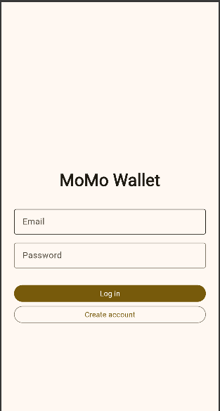

# MoMo Wallet

A mobile money wallet app. It signs users in with Firebase Authentication, and each user's transactions are saved in Cloud Firestore under their own id, so two accounts never see each other's data, and every change appears live.

## Features
- Create an account, log in and log out (Firebase Authentication, email and password)
- Every new account starts with sample transactions
- Balance, total IN and total OUT are computed from the transactions, never saved
- Filter the list: All, IN or OUT
- Add a transaction: the description cannot be empty, the amount must be a whole number above 0, and an OUT bigger than the balance is refused
- Edit a transaction (tap) and delete one (long press, after an "Are you sure?" dialog)
- Live updates: a change made anywhere (the app or the Firebase console) appears at once, without a refresh
- Loading, error and empty states on the wallet screen

## How the data is stored
`users/{uid}/transactions/{id}` with the fields `description`, `amount`, `isIn` and `createdAt`.
The Firestore rules (`firestore.rules`) allow a user to read and write only under their own `uid`, and only when signed in. Test mode is not used.

## Screenshots

